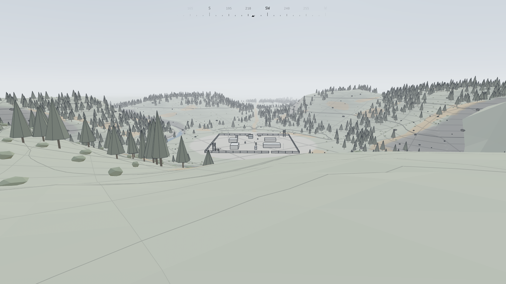

# Sightline

A first-person stealth-sniper game. Each mission is a freshly generated enemy camp that you scout, plan against and take apart your own way.

**Where it stands:** Phase 0 · Foundations passed its gate on Nov 7, 2026, and the foundation pass after it is done. That gives a deterministic simulation, a walkable wireframe valley, and the tooling every later system builds on. Phase 1, five labs, is planned in [docs/phase-1-plan.md](docs/phase-1-plan.md): a short pass of shared seams, then the labs in two waves.

The design lives in the [Sightline · Game Design & Build Plan](https://claude.ai/artifact/Q7JxvgeF1zrrTEWNrFQy7j), with a copy in [docs/design-doc.md](docs/design-doc.md). Other documents record the work so far:
- [docs/phase-0-report.md](docs/phase-0-report.md): Phase 0.
- [docs/foundation-plan.md](docs/foundation-plan.md): the pass after it.
- [docs/phase-1-plan.md](docs/phase-1-plan.md): Phase 1, its labs and their status.
- [docs/foundation-shape.md](docs/foundation-shape.md): the kernel, the lanes and their benches, the shape every lab builds into.
- [docs/research/](docs/research/README.md): the prior art each lab starts from, and aims past.
- [docs/decisions.md](docs/decisions.md): the reasoning behind each change.



## Run it

```sh
npm install
npm run dev
```

Open http://localhost:5173 and click to begin. Requires Node 20.19+ or 22.12+.

| Key | Action |
| --- | --- |
| W A S D | Move |
| Shift | Sprint |
| C | Crouch (toggle) |
| Z | Prone (toggle) |
| Right mouse or F (hold) | Zoom |
| Left mouse | A test shot, drawn in the debug view (the rifle comes with lab B) |
| M | Mark this moment (it shows on the replay's timeline) |
| F3 or \` | Switch between the honest view and the debug view |
| Esc | Pause; the pause screen holds the settings |

In the debug view only:

| Key | Action |
| --- | --- |
| B | Show every collider: purple blocks everything, blue blocks movement, green blocks sight |
| O | Show overwatch perches and their sightlines to the camp |
| G | Show the spatial grid |
| N | Fly camera (Space or E up, Q down, Shift fast) |
| [ and ] | Slow down or speed up time (0.25× to 8×) |
| R | Restart the run |

While watching a replay:

| Key | Action |
| --- | --- |
| P | Play or pause |
| ← and → | Back or on 5 seconds |
| , and . | Back or on one tick |
| [ and ] | Slower or faster (¼× to 8×) |

The debug view's other keys work in a replay too, whichever view is showing.

URL options:
- `?seed=TAL-4471` picks a valley.
- `?scene=movement-course` plays a scene.
- `?view=debug` starts in the debug view.
- `?spawn=edge` starts where the road leaves the map.
- `?bench` runs a 20-second performance flythrough.
- `?dpr=2` renders at a higher resolution.
- `?replay=playtests/<name>.slrec` watches a kept run (development build only).

## The two views

The **honest view** shows only what the finished game will show: the world and a compass.

The **debug view** shows everything the simulation knows:
- guard sight cones and routes;
- footstep sound rings, sized to how far they carry;
- the rangefinder;
- performance and player state;
- what each system draws to explain itself.

Playtests use the honest view; tuning uses the debug view.

## Playtests and replays

Every run is kept as it's played, after every minute and whenever the game pauses:
- **The development build** writes the recording and a telemetry report into `playtests/`.
- **The deployed game** keeps the last five runs in the browser and offers them on the start and pause screens.

`npm run playtest` re-simulates each kept run, checks it bit for bit, and summarizes it.

To watch a run, drop its recording on the page, pick it from the start screen (Watch a recording…), or open it with `?replay=`. Seeking is exact. You can watch from the player's eyes or the fly camera, with the debug views.

## Scripts

| Command | What it does |
| --- | --- |
| `npm run dev` | Dev server with hot reload. Saving `src/config/tuning.ts` applies new numbers to the running game. |
| `npm run check` | Typecheck plus every test. Must pass before anything is handed back. |
| `npm test` | All tests: determinism, the motor's promises, collision, generation, recordings, scenes, architecture rules. |
| `npm run test:browser` | Tests that need a real browser (Web Audio, WebGL, each engine's JavaScript), in Chromium. |
| `npm run look` | Pictures of the honest and debug views from a headless browser, into `shots/`. |
| `npm run sim -- --minutes 10` | Headless run: a bot plays a valley at about 2,000× real time, records it, re-simulates the recording and checks it matches bit for bit. |
| `npm run sim -- --replay file.slrec` | Re-simulates a recording saved from the browser, and says where a run diverged. |
| `npm run scene` | Every scene headless, by its own driver, checking its expectations. |
| `npm run seeds -- --count 100` | Generates many valleys and reports validation, timing, overwatch and access. |
| `npm run fuzz -- --seeds 20 --minutes 60` | Bots play fresh valleys while every body's promises are checked every tick. |
| `npm run playtest` | Re-simulates and summarizes the runs kept in `playtests/`. |
| `npm run selftest` | The golden values, in this JavaScript engine. |
| `npm run golden` | Rewrites the golden recording after a deliberate behaviour change. |
| `npm run bench` | Every lane's bench: pinned runs, the work each system does, quality metrics. |
| `npm run explain` | For every pinned run that moved since `origin/main`: where it first diverged, and what changed. |
| `npm run land -- <number>` | Merges a pull request, only if it is up to date with `main` and green. |
| `npm run build` | Production build into `dist/`. |

## How it fits together

```
src/config/tuning.ts   every gameplay number and content definition, hot-reloadable
src/sim/               the simulation: pure TypeScript, no rendering, no DOM, deterministic
  lanes.ts             the lane map: which layer may import which (docs/foundation-shape.md)
  kernel/              runs any game, imports nothing else
    core/              fixed-step clock, seeded RNG, deterministic math, hashing, seeds
    world/             heightfield, colliders and solids, the world query, the grid, surfaces
    record/            recordings, re-simulation and exact seeking
    *.ts               the state tree, the tick and its declared access, events and commands,
                       input, the environment and sound, the scene harness, the kernel alone
  generation/          lane: the valley, sites, the camp, routines, analysis and validation
  body/                lane: the shared motor every body moves with, body shapes, the head bob
  perception/          lane: how visible a body is, and percepts
  brain/               lane: brains, behind the perception boundary (a guard knows only his mind)
  ballistics/          lane: empty until lab B
  game/                Sightline: the player and guards, its systems, setup, scenes, bots, self-test
src/render/            three.js wireframe renderer; reads snapshots, never writes
src/audio/             the sound engine and its voices
src/app/               the browser loop, input and actions, HUD, overlay, sound, playtests, replays
src/headless/          command-line tools
tests/                 Vitest
```

The simulation runs at a fixed 30 Hz, and the renderer interpolates between ticks.

Given the same seed, tuning and inputs, it produces bit-identical results in Node, in Bun, and in Chromium, Firefox and Safari's engines. That one property makes recordings replayable, bugs reproducible, seeds shareable and headless tests trustworthy. `tests/architecture.test.ts` guards it.

`CLAUDE.md` has the working rules for anyone, human or agent, extending the code.
