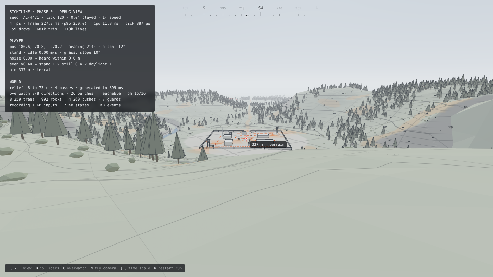

# Sightline

A first-person stealth-sniper game for the browser. Each mission is a freshly generated enemy camp that you scout, plan against and take apart your own way.

It's early, and wireframe on purpose. The rule is to prove the core with plain shapes first: if a mission isn't tense with capsules and boxes, more content won't save it. Art comes after that.

**[Play the latest build](https://sightline-brown.vercel.app)** in a desktop browser with a mouse and keyboard. It's whatever is on `main`: a walkable valley with a test camp and both views, not yet a mission.


## What's different about it

- **Every run replays bit for bit, in every engine.** Given the same seed, tuning and inputs, the simulation produces bit-identical results in Node, in Bun, and in Chromium, Firefox and Safari's engines. Every run is kept as a recording while you play. A recording re-simulates anywhere and seeks exactly, so a bug it caught can be reproduced. CI checks this on Linux, macOS and Windows, and in all three browser engines, on every change.
- **The honest view.** The game draws two views. The honest view shows only what the finished game will show; the debug view shows everything the simulation knows. Fairness is tested in the honest view: the perception lab passes only when testers predict detection from its cues alone.
- **Guards know only what they perceive.** A guard's brain decides from its own mind, and perception is the only way anything about you reaches it. A test checks that guards with the same mind decide the same wherever the unseen player stands.
- **Changes explain themselves.** Golden fingerprints pin what the game does. When one moves, `npm run explain` and `npm run bisect` say where two builds part ways: the first tick, then the system, then the state paths it left different.

## Where it stands

**Phase 0** (foundations) passed its gate on Nov 7, 2026. It built a deterministic simulation, a walkable wireframe valley with a test camp, and the tooling every later system builds on.

**Phase 1 is under way.** It has five labs. Each lab is an isolated wireframe scene, built to its exit test before anything is integrated:

| Lab | Builds | Exit test |
| --- | --- | --- |
| A | Perception and awareness | Testers predict detection 80% of the time in the honest view |
| B | Shooting | A 300 m shot at a walking target feels earned |
| C | Movement and body | Players predict their own noise and visibility |
| D | Camp generator | 90 of 100 seeds pass validation on the first try |
| E | Camp brain | Escalation can be caused, contained and interrupted |

Labs A, B and D run first, each on its own branch and pull request. C and E follow, building on A's percepts. [docs/phase-1-plan.md](docs/phase-1-plan.md) has every milestone and its status. Phase 2 then joins the labs into one core mission.

## Run it locally

You need Node 20.19+ or 22.12+, and a desktop browser with WebGL 2.

```sh
npm ci
npm run dev
```

Open http://localhost:5173 and click to begin.

```sh
npm run check
```

That's the typecheck and every test. The tests that need a real browser run with `npm run test:browser`, after a one-time `npx playwright install chromium`.

### Controls

| Key | Action |
| --- | --- |
| W A S D | Move |
| Shift | Sprint |
| C | Crouch (toggle) |
| Z | Prone (toggle) |
| Right mouse or F (hold) | Zoom |
| Left mouse | A test shot, drawn in the debug view (the rifle comes with lab B) |
| M | Mark this moment (it shows on the replay's timeline) |
| F3 or \` | Switch between the honest view and the debug view |
| Esc | Pause; the pause screen holds the settings |

In the debug view only:

| Key | Action |
| --- | --- |
| B | Show every collider: purple blocks everything, blue blocks movement, green blocks sight |
| O | Show overwatch perches and their sightlines to the camp |
| G | Show the spatial grid |
| N | Fly camera (Space or E up, Q down, Shift fast) |
| [ and ] | Slow down or speed up time (0.25× to 8×) |
| R | Restart the run |

While watching a replay:

| Key | Action |
| --- | --- |
| P | Play or pause |
| ← and → | Back or on 5 seconds |
| , and . | Back or on one tick |
| [ and ] | Slower or faster (¼× to 8×) |

The debug view's other keys work in a replay too, whichever view is showing.

URL options:
- `?seed=TAL-4471` picks a valley.
- `?scene=movement-course` plays a scene.
- `?view=debug` starts in the debug view.
- `?spawn=edge` starts where the road leaves the map.
- `?bench` runs a 20-second performance flythrough.
- `?dpr=2` renders at a higher resolution.
- `?replay=playtests/<name>.slrec` watches a kept run (development build only).

## The two views

The **honest view** shows only what the finished game will show: the world and a compass.

The **debug view** shows everything the simulation knows:
- guard sight cones and routes;
- footstep sound rings, sized to how far they carry;
- the rangefinder;
- performance and player state;
- what each system draws to explain itself.

Playtests use the honest view; tuning uses the debug view.



## Playtests and replays

Every run is kept as it's played, after every minute and whenever the game pauses:
- **The development build** writes the recording and a telemetry report into `playtests/`.
- **A production build,** such as the public one, keeps the last five runs in the browser and offers them on the start and pause screens.

`npm run playtest` re-simulates each kept run, checks it bit for bit, and summarizes it.

To watch a run, drop its recording on the page, pick it from the start screen (Watch a recording…), or open it with `?replay=`. Seeking is exact. You can watch from the player's eyes or the fly camera, with the debug views.

## How it's built

The simulation, `src/sim`, is pure TypeScript: no rendering, no DOM, a fixed 30 Hz tick. The three.js renderer reads its snapshots, never writes to it, and interpolates between ticks.

Inside `src/sim` are three layers ([docs/foundation-shape.md](docs/foundation-shape.md)):
- **The kernel** runs any game and imports nothing else: deterministic math and random streams, the state tree, the tick, recordings, the world.
- **Five lanes,** each behind its `index.ts`: body, perception, brain, ballistics and generation. `src/sim/lanes.ts` says which may import which, and a test enforces it.
- **The game** is Sightline itself: its entity kinds, its systems in their phases, its scenes and its rules.

A few rules keep the simulation deterministic. `CLAUDE.md` has the full list.
- **Only exactly specified math.** Engines disagree in the last bit of `Math.sin`, so the simulation uses arithmetic, `Math.sqrt` and its own `detmath`. It never uses `Math.random`, clocks or timers.
- **All state in one tree of plain data,** so the hash, save-states and restore cover everything.
- **Systems declare what they read, write and emit.** The simulation refuses two systems that touch the same data without a declared order.
- **Random streams fork by label and by entity,** so removing one guard never shifts another's numbers, and an old seed keeps building the same valley.
- **Behaviour moves only on purpose.** Golden fingerprints pin what the game does in a set of pinned runs. A change that moves one says why, and bumps a version.

### Layout

```
src/config/tuning.ts   every gameplay number and content definition, hot-reloadable
src/sim/               the simulation: pure TypeScript, no rendering, no DOM, deterministic
  lanes.ts             the lane map: which layer may import which (docs/foundation-shape.md)
  kernel/              runs any game, imports nothing else
    core/              fixed-step clock, seeded RNG, deterministic math, hashing, seeds
    world/             heightfield, colliders and solids, the world query, the grid, surfaces
    record/            recordings, re-simulation and exact seeking
    *.ts               the state tree, the tick and its declared access, events and commands,
                       input, the environment and sound, the scene harness, the kernel alone
  generation/          lane: the valley, sites, the camp, routines, analysis and validation
  body/                lane: the shared motor every body moves with, body shapes, the head bob
  perception/          lane: sight, hearing, percepts and beliefs, the awareness ladder
  brain/               lane: brains, behind the perception boundary (a guard knows only his mind)
  ballistics/          lane: empty until lab B
  game/                Sightline: the player and guards, its systems, setup, scenes, bots, self-test
src/render/            three.js wireframe renderer; reads snapshots, never writes
src/audio/             the sound engine and its voices
src/app/               the browser loop, input and actions, HUD, overlay, sound, playtests, replays
src/headless/          command-line tools
tests/                 Vitest
```

## Commands

| Command | What it does |
| --- | --- |
| `npm run dev` | Dev server with hot reload. Saving `src/config/tuning.ts` applies new numbers to the running game. |
| `npm run check` | Typecheck plus every test. Must pass before anything is handed back. |
| `npm test` | All tests: determinism, the motor's promises, collision, generation, recordings, scenes, architecture rules. |
| `npm run test:browser` | Tests that need a real browser (Web Audio, WebGL, each engine's JavaScript), in Chromium. |
| `npm run look` | Pictures of the honest and debug views from a headless browser, into `shots/`. |
| `npm run sim -- --minutes 10` | Headless run: a bot plays a valley at about 2,000× real time, records it, re-simulates the recording and checks it matches bit for bit. |
| `npm run sim -- --replay file.slrec` | Re-simulates a recording saved from the browser, and says where a run diverged. |
| `npm run scene` | Every scene headless, by its own driver, checking its expectations. |
| `npm run seeds -- --count 100` | Generates many valleys and reports validation, timing, overwatch and access. |
| `npm run fuzz -- --seeds 20 --minutes 60` | Bots play fresh valleys while every body's promises are checked every tick; `--synctest` also saves, restores and re-steps every 30 ticks. |
| `npm run playtest` | Re-simulates and summarizes the runs kept in `playtests/`. |
| `npm run selftest` | The golden values, in this JavaScript engine. |
| `npm run golden` | Rewrites the golden recording after a deliberate behaviour change. |
| `npm run bench` | Every lane's bench: pinned runs, the work each system does, quality metrics. |
| `npm run explain` | For every pinned run that moved since `origin/main`: where it first diverged, and what changed. |
| `npm run trace -- --run <name>` | The per-tick trace of one pinned run, which `explain` compares. |
| `npm run land -- <number>` | Merges a pull request, only if it is up to date with `main` and green. |
| `npm run bisect -- --recording <file>` | Where this build and the one that made a recording part ways: tick, system, state paths. |
| `npm run build` | Production build into `dist/`. |

## The documents

- [docs/design-doc.md](docs/design-doc.md): the design, from the vision to the roadmap. It's a copy of the owner's working doc, which is private.
- [docs/phase-0-report.md](docs/phase-0-report.md): Phase 0.
- [docs/foundation-plan.md](docs/foundation-plan.md): the pass after it.
- [docs/phase-1-plan.md](docs/phase-1-plan.md): Phase 1, its labs and their status.
- [docs/foundation-shape.md](docs/foundation-shape.md): the kernel, the lanes and their benches, the shape every lab builds into.
- [docs/research/](docs/research/README.md): the prior art each lab starts from, and aims past.
- [docs/decisions.md](docs/decisions.md): the reasoning behind each change.
- [CLAUDE.md](CLAUDE.md): the working rules for anyone extending the code, human or agent.

## About the project

Sightline is a personal project, built with Claude Code, and public so that anyone can read the code and play the build. Bug reports are welcome, best with a recording; it isn't looking for contributors. [CONTRIBUTING.md](CONTRIBUTING.md) says how to report a bug.

## License

[MIT](LICENSE), © 2026 Will Gibson. It covers the code and the documents, and grants no rights to the name Sightline.
