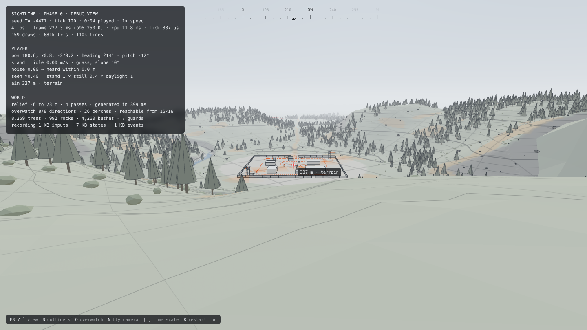
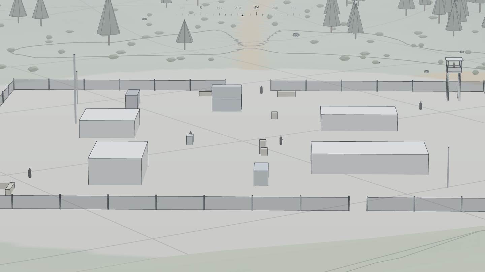

# Phase 0 report · Foundations

**Gate: Engine runs. Passed on Nov 7, 2026.** The valley is walkable, the simulation runs headless, and a recording made in the browser re-simulates bit for bit in Node. The owner played it and approved the look. It ran at 120 fps on the owner's Mac. Everything Phase 0 lists is built except deploys, which wait on the owner's go-ahead.

*The debug view from the overlook. These screenshots come from software rendering on the build machine, which is why the panel shows 4 fps.*

## What was built

| Design doc item | Status | Where |
| --- | --- | --- |
| Repo | Done. Pinned toolchain, lockfile for every platform, strict TypeScript, tests, docs. | `package.json`, `CLAUDE.md` |
| Deploys | Not started. Needs the owner's go-ahead for a Vercel project. | — |
| Sim core: fixed step | Done. 30 Hz, interpolated rendering, catch-up cap. | `src/sim/core/clock.ts`, `src/app/game.ts` |
| Sim core: seeded random generator | Done. Streams forked by label; seeds look like TAL-4471. | `src/sim/core/rng.ts`, `seed.ts` |
| Sim core: config | Done. One tuning file, hot-reloaded into the running game. | `src/config/tuning.ts` |
| Wireframe renderer | Done. Topographic terrain, edged props, capsule guards, fog, backdrop to the horizon, tiled for culling. | `src/render/` |
| First-person controller | Done. Walk, sprint, crouch and prone at the doc's speeds; slopes, collision, step-up, falling, headroom, footstep noise. | `src/sim/entities/player.ts` |
| Debug and honest views | Done. Plus a collider view, an overwatch view, a fly camera and time scaling. | `src/render/debugLayer.ts`, `src/app/hud.ts` |
| Recorder | Done. Inputs per tick, state at 10 Hz, events, checkpoint hashes; saved from the pause menu. | `src/sim/record/` |
| Walkable valley | Done. Ridges, passes, creek gorges, a road, forest, rocks, bushes and a static test camp with 7 guards. | `src/sim/gen/` |
| Headless sim | Done. Bot runs, re-simulation, seed reports. | `src/headless/`, `src/sim/bots/` |
| Performance spike | Done in software rendering. Real-GPU numbers pending (see below). | `?bench` |

## Measurements

Measured in Node 22 on the build machine, with no GPU, so rendering ran in software (SwiftShader).

| Measure | Result |
| --- | --- |
| Valleys valid on first generation | 100 of 100 |
| Generation time | mean 253 ms, p95 327 ms |
| Simulation speed, headless | 20 minutes of play in about 0.3 s (8 µs per tick, about 4,000× real time), and in 0.1 s on the owner's Mac. The stricter controller costs 3 µs per tick more than the first version. |
| Recording size, 20-minute run | 2.65 MB (inputs 0.4 MB, states 2.0 MB, events 0.2 MB) |
| Re-simulating that recording | under 0.2 s, identical at all 120 checkpoints |
| Browser recording re-simulated in Node | identical (512 ticks: sprint, crouch, prone, turning, patrols) |
| Same 20-minute bot run on x64 and on Apple-silicon arm64 (the owner's Mac) | identical final hash (`9a5bf04b64d3ed63`) |
| Production bundle | 637 KB (172 KB gzipped) |
| Draw calls and triangles, benchmark flythrough | 66 draw calls, 434k triangles on average |
| Tests | 65 passing: controller and its edge cases, collision, raycasts against brute force, generation, recordings, determinism, invariants over long bot runs, architecture rules |
| Controller invariants, 8 valleys × 12 minutes of bot play (172,800 ticks) | never below the terrain or inside a solid object; never rose more than one step (0.45 m) or moved further than a sprint stride (0.185 m) in a tick |

**On the owner's Mac:** 120 fps, which is the display's limit, at 8.3 ms per frame (p95 9.3 ms). That used 1.4 ms of CPU per frame, 134 draw calls, 522k triangles and 345k lines, with the debug view and collider outlines on. The budget is 60 fps on a mid-range laptop at 1080p; `?bench` runs a repeatable 20-second flythrough for weaker machines.

## Problems found and fixed

- **Chrome and Node disagreed on `Math.atan2`.** A browser recording failed to re-simulate in Node. All simulation trigonometry now uses deterministic implementations, and a test forbids the native functions anywhere in `src/sim`.
- **A fresh-eyes code review found four controller bugs.** All four are fixed, each with a regression test:
    - Getting up from prone skipped its 0.75 s if you held sprint or tapped crouch. Prone changes now can't be interrupted, and a toggle pressed meanwhile is queued.
    - Momentum carried a sprint up cliffs of any steepness, 8 m up an 85° face. The controller now checks the slope where you are moving to, not just where you stand, and never rises more than one step per tick.
    - A guard walking head-on could shove the player straight through a fence. Guards are now resolved before walls, and each shove is capped at 8 cm so walls always win.
    - Stepping up under a low ceiling could throw the player 2 m sideways. Ceilings now block the move instead of pushing you out.
- **Smaller review fixes:**
    - Footstep noise and stride now follow your actual speed, so diving prone from a sprint is loud until you've stopped.
    - Crouching while holding sprint no longer stands you straight back up.
    - The simulation quantizes its own input, so any caller's run can be recorded and replayed.
    - Hot reload now rebuilds the valley exactly when generation inputs change, and only marks a recording as unreplayable when gameplay numbers change.
- **The first fix made walls sticky.** A player resting against a wall counted as standing under a ceiling, so 31% of moving ticks near objects froze. A stress measurement caught it before delivery. After the fix, the fallback that cancels a move never fired in 43,200 ticks of bot play.
- **Low rocks could turn into walls.** A player brushing a rock's edge stood on the terrain beside it, so when the slope dropped a few centimetres the rock became a wall the player was already inside (found by the invariant run, 1 tick in 108,000). Overlapping a low ledge now means standing on it.
- **The validation metric rejected the best valleys.** Counting contiguous perch runs treated a valley with perches all the way round as one ridge. Validation now counts compass sectors.
- **Debug cones washed the camp orange.** They were drawn at 60 m. They now show 30 m and fade.
- **Ground-level terrain looked crumpled.** Fine relief came down from 1.4 m to 0.9 m and the lighting contrast was softened.

*Zoomed on the camp from the overlook at about 330 m: guards on patrol and in a tower, and beyond the fence, the road where the creek crosses it.*

## Known gaps, carried into Phase 1

- **The terrain is gentle.** Under 2% of the play area is too steep to walk, so every valley passes validation easily. Lab D adds cliffs and chokepoints that make approach routes a real choice.
- **Guards are dummies.** They hold posts, sweep their gaze and walk routes, but perceive nothing. Labs A and E add perception and the camp brain.
- **No weapon yet.** Zoom is a binocular placeholder; lab B builds the rifle and ballistics.
- **Movement has no lean, mantle, ladders or body carrying yet.** Lab C adds them, and judges whether 30 Hz interpolation feels responsive enough.
- **The camp is a static test layout**, mirrored at random. Lab D replaces it with the generator.
- **Generation runs on the main thread** for about 0.3 s at load. It moves to a worker when it grows.

## Owner's gate check, Nov 7

1. **Movement:** crouching and going prone work. Whether it feels deliberate enough gets judged once there is more gameplay.
2. **Look:** the pale, contour-lined wireframe is approved as the canvas for the next phases.
3. **Performance:** 120 fps on the owner's Mac (display limit), with 1.4 ms of CPU per frame.
